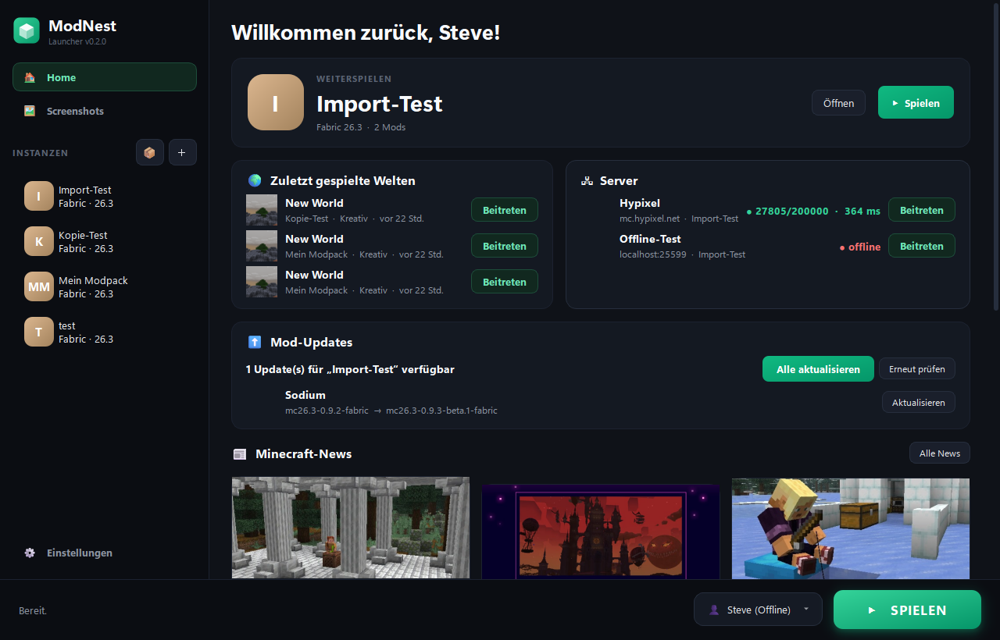
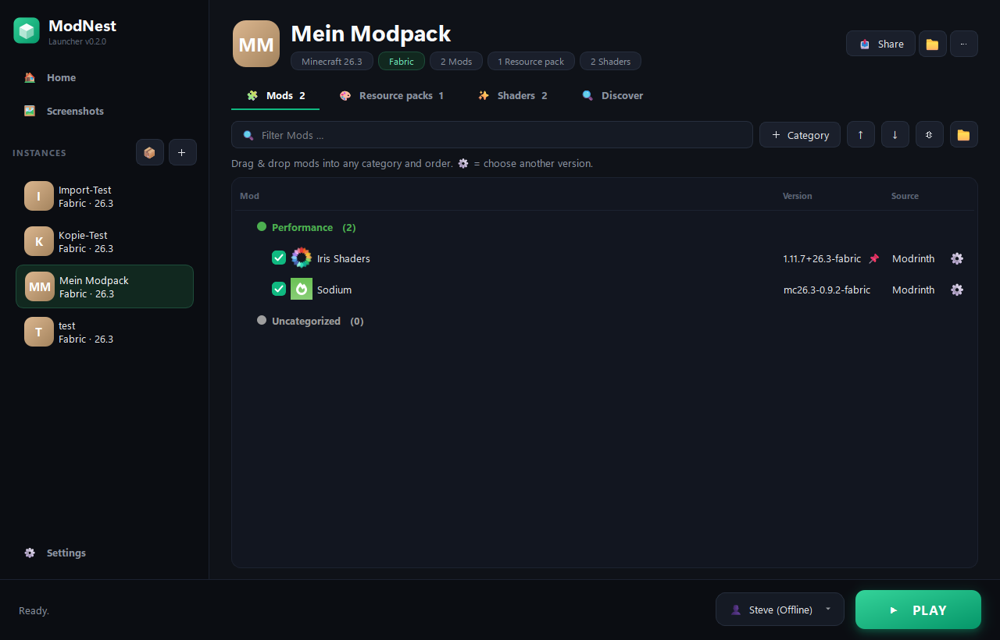
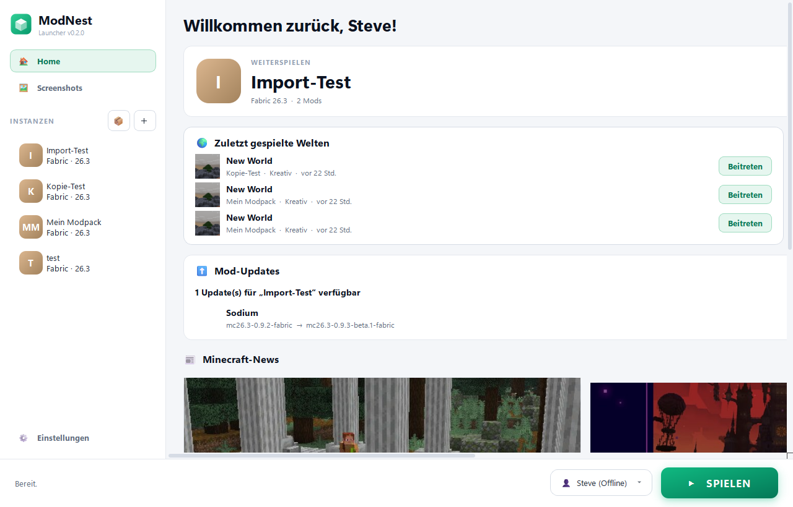
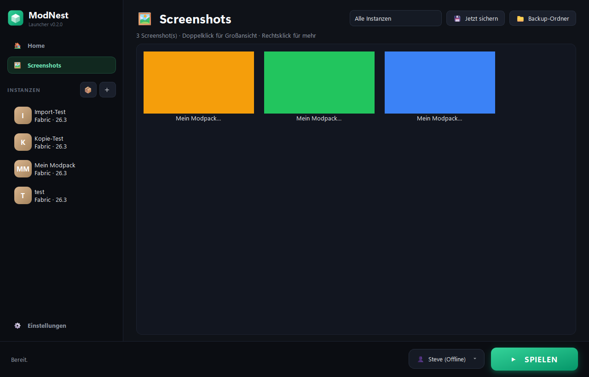

# ⛏ ModNest Launcher

Ein Minecraft-Launcher für Windows, mit dem du **Mods, Texturepacks und Shader** direkt von **Modrinth** und **CurseForge** installierst und so ordnest, wie du willst: per **Drag & Drop** und in **eigenen Kategorien** wie „Performance“, „Grafik & Optik“ oder „PvP“.

  

## Features

**Home**
- **Weiterspielen** mit der zuletzt gespielten Instanz
- **Zuletzt gespielte Welten und Server** mit **Beitreten**: Das Spiel springt direkt in die Welt bzw. auf den Server (ab Minecraft 1.20)
- **Server-Status live**: online/offline, Spieler (z.B. 27.800/200.000) und Ping
- **Mod-Updates** mit „Alle aktualisieren“
- **Minecraft-News** und Patch-Notes von Mojang

**Mods, Texturepacks & Shader verwalten**
- Je ein eigener Tab mit denselben Funktionen
- **Drag & Drop** in jede Reihenfolge und Kategorie, auch ganze Kategorien
- **Eigene Kategorien** anlegen, umbenennen, einfärben und löschen. Neue Inhalte werden **automatisch einsortiert**
- Per Checkbox aktivieren oder deaktivieren
- **⚙ Versionswahl**: optional eine ältere Version wählen (📌 markiert)
- **Texturepack-Reihenfolge** wird ins Spiel übernommen, **Iris** lässt sich mit einem Klick installieren
- Dateien einfach **ins Fenster ziehen**, sie landen automatisch im richtigen Tab

**Entdecken**
- Suche auf **Modrinth** und **CurseForge**, gefiltert nach Version und Loader der Instanz
- **Pflicht-Abhängigkeiten** werden mitinstalliert

**Instanzen & Modpacks teilen**
- Vanilla, Fabric, Quilt, Forge, NeoForge
- **Eigene Icons**, **Kopieren**, **Spielzeit**
- **Export/Import** als **Modrinth-Pack (.mrpack)** oder **CurseForge-Pack (.zip)**: funktioniert in Modrinth App, CurseForge App, Prism, ATLauncher, MultiMC …

**Screenshots, Backups & Cloud**
- **Screenshot-Galerie** aller Instanzen mit Großansicht
- **Automatische Backups** von Welten (nach dem Spielen) und Screenshots, mit Wiederherstellung
- Der Backup-Ordner lässt sich per Klick in **OneDrive, Dropbox, iCloud Drive oder Google Drive** legen

**Sonstiges**
- **Absturz-Helfer**: zeigt die Ursache und verdächtige Mods an (mit „deaktivieren“-Button)
- **Hell/Dunkel/„Wie Windows“**, **Deutsch/English**, **RAM-Schieberegler** mit Empfehlung
- **Offline-Konten** und **Microsoft-Login** (Device-Code-Flow, Tokens mit Windows-DPAPI verschlüsselt)
- Startbildschirm mit Ladebalken, kein Konsolenfenster, Hinweis bei neuen ModNest-Versionen

  
  

  
  

## Installation

Voraussetzung: **Windows** und **[Python 3.10+](https://www.python.org/downloads/)**

1. Repository herunterladen (grüner Button **Code → Download ZIP**) und entpacken.
2. **`start.bat`** doppelklicken. Beim ersten Start wird die Python-Umgebung eingerichtet, was etwa eine Minute dauert. Außerdem wird die Verknüpfung **ModNest** auf dem Desktop angelegt.
3. Danach startest du den Launcher einfach über die Verknüpfung **ModNest**.

Alle Daten (Instanzen, Einstellungen, Konten) liegen unter `%APPDATA%\ModNest`.

## CurseForge-API-Key

CurseForge verlangt für Drittanbieter-Launcher einen eigenen API-Key. Den bekommst du kostenlos auf [console.curseforge.com](https://console.curseforge.com) und trägst ihn im Launcher unter **⚙ Einstellungen** ein. Modrinth funktioniert ohne Key.

## Microsoft-Login

Microsoft verlangt, dass jeder Launcher eine eigene, für Minecraft freigeschaltete Azure-App verwendet:

1. Auf [portal.azure.com](https://portal.azure.com) unter **App-Registrierungen** eine neue App anlegen (Kontotyp: persönliche Microsoft-Konten).
2. Unter **Authentifizierung → Erweiterte Einstellungen** die Option **„Öffentliche Clientflows zulassen“** auf **Ja** stellen.
3. Die **Anwendungs-ID (Client-ID)** im Launcher unter **⚙ Einstellungen** eintragen.
4. Die Freischaltung für die Minecraft-API beantragen: [aka.ms/mce-reviewappid](https://aka.ms/mce-reviewappid)

Ohne Microsoft-Login kannst du mit einem **Offline-Konto** im Einzelspieler und im LAN spielen.

## Technik

- Python mit [PySide6](https://doc.qt.io/qtforpython-6/) (Qt) für die Oberfläche
- [minecraft-launcher-lib](https://codeberg.org/JakobDev/minecraft-launcher-lib) für Installation und Start
- [Modrinth API](https://docs.modrinth.com/api/) und [CurseForge API](https://docs.curseforge.com/rest-api/)

---

*Nicht offiziell mit Mojang Studios oder Microsoft verbunden. Minecraft ist eine Marke von Mojang Studios.*
