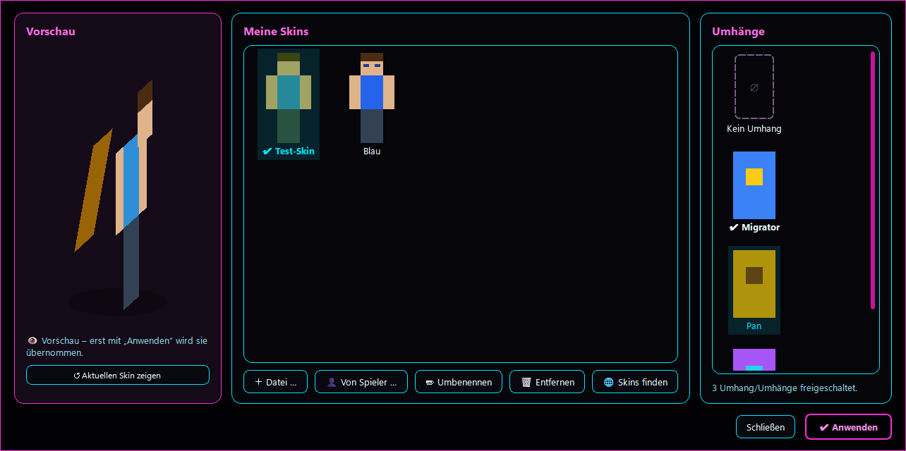
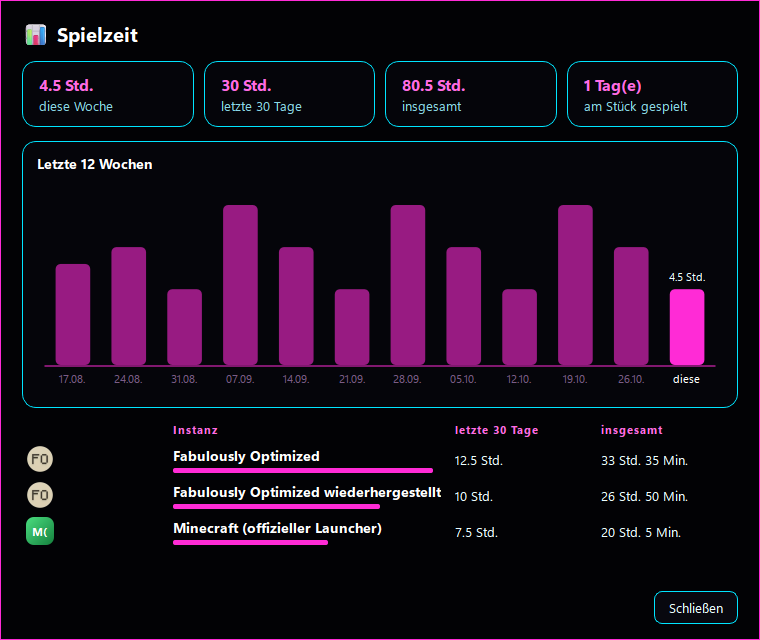
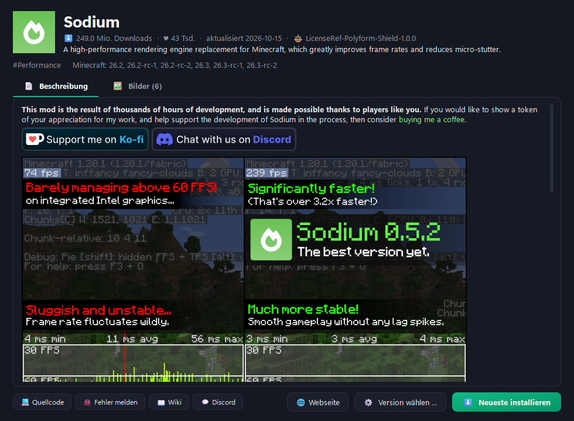
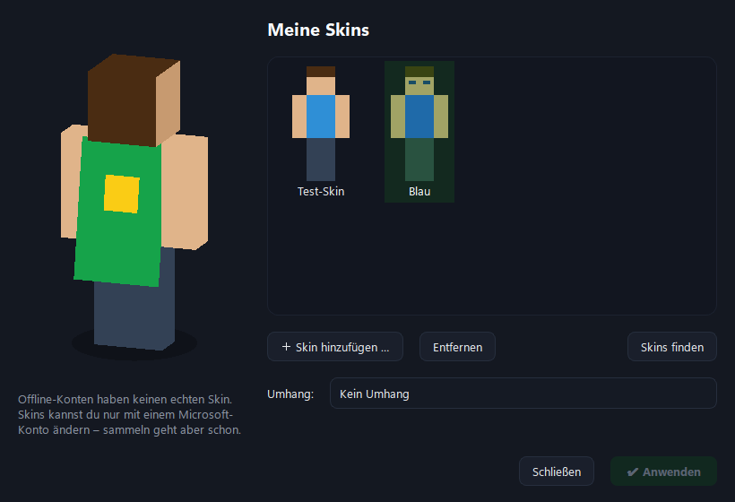
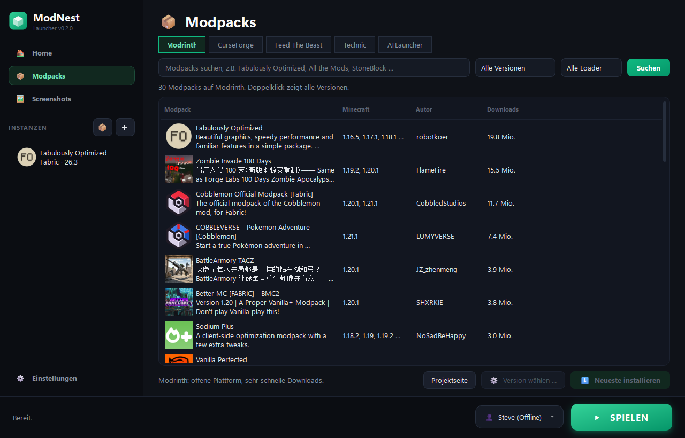
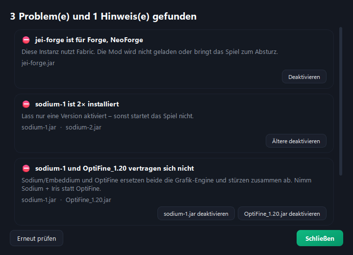

# ⛏ ModNest Launcher

Ein Minecraft-Launcher für Windows: **fertige Modpacks** von Modrinth, CurseForge, Feed The Beast, Technic und ATLauncher mit einem Klick, dazu **Mods, Texturepacks und Shader**, die du frei ordnest – per **Drag & Drop** und in **eigenen Kategorien** wie „Performance“, „Grafik & Optik“ oder „PvP“.

<p align="center">
  
</p>

## Features

**Fertige Modpacks**
- Suchen und installieren von **Modrinth, CurseForge, Feed The Beast, Technic und ATLauncher**, mit Filter nach Minecraft-Version und Loader
- **Versionswahl mit Changelog**, empfohlener Arbeitsspeicher wird automatisch übernommen
- **Modpack-Updates** auf Home – deine Welten, Einstellungen und selbst hinzugefügten Mods bleiben erhalten, vorher wird automatisch ein Backup angelegt
- **Download-Hilfe** für Mods, die nur über die Webseite geladen werden dürfen: Datei im Browser laden, ModNest erkennt sie im Downloads-Ordner und baut sie ein
- **Parallele, geprüfte Downloads** (Prüfsummen, automatische Wiederholung)

**Neu in 0.5**
- **🔗 Pack-Code**: eine Instanz als Text teilen (z.B. in Discord) – Freunde bekommen per „Pack-Code einlösen“ genau dieselben Mods in denselben Versionen
- **🔔 Server-Benachrichtigungen** pro Server: wenn er online kommt, jemand draufkommt oder bestimmte Freunde online sind
- **↩ Mod-Update rückgängig**: per Rechtsklick zurück zur vorherigen Version
- **📊 Spielzeit-Statistik** mit Wochen-Diagramm und Zeit pro Instanz
- **💜 Neon-Design** und **eigene Akzentfarbe**
- **👕 Neues Skin-Fenster**: 3D-Vorschau, Skin-Bibliothek (dein aktueller Skin wird automatisch gesichert), Umhänge mit Bild, Skins anderer Spieler per Name laden
- **RAM-Check** vor dem Start, wenn gerade zu wenig Arbeitsspeicher frei ist

<p align="center">
  
  
</p>

**Entdecken**
- **Projektseite im Launcher**: Beschreibung mit Bildern, Galerie, Downloads, Kategorien und Links – für Mods, Texturepacks, Shader und Modpacks
- **Filter nach Kategorie** und **Sortierung** (beliebt, Downloads, zuletzt aktualisiert, neueste)

**Home**
- **Weiterspielen**, **zuletzt gespielte Welten und Server** mit **Beitreten** (ab Minecraft 1.20)
- **Server-Status live**: online/offline, Spieler und Ping
- **🖥 Desktop-Verknüpfung** direkt auf einen Server oder in eine Welt, **🗺 BlueMap-Karte** eines Servers im eigenen Fenster
- **Updates** für Mods und Modpacks, jeweils mit „Was ist neu?“
- **Minecraft-News** und Patch-Notes

**Mods, Texturepacks & Shader verwalten**
- Je ein Tab mit **Drag & Drop**, **eigenen Kategorien**, Filter (Strg+F) und Mehrfachauswahl
- **🩺 Kompatibilitäts-Check**: findet Mods für den falschen Loader, doppelte Mods, fehlende Abhängigkeiten und bekannte Konflikte (z.B. Sodium + OptiFine) – mit Ein-Klick-Lösung
- **⚡ Performance-Paket**: Sodium, Lithium, FerriteCore, ModernFix & Co. passend zu Version und Loader
- **🗂 Mod-Profile**: An/Aus-Zustände speichern („PvP“, „Shader-Modus“, „Laptop“) und mit einem Klick umschalten
- **⚙ Versionswahl** für jeden Eintrag, Texturepack-Reihenfolge wird ins Spiel übernommen
- **📝 Notizen pro Mod**, z.B. „nicht updaten, crasht mit X“

**Instanzen**
- Vanilla, Fabric, Quilt, Forge, NeoForge – mit **eigenen Icons**, **Kopieren**, **Spielzeit**
- **Ordner** in der Seitenleiste, Reihenfolge per Drag & Drop
- **Eigene Einstellungen pro Instanz**: Arbeitsspeicher, Java, Java-Argumente
- **Import aus anderen Launchern**: CurseForge App, Modrinth App, Prism, MultiMC, ATLauncher und Welten aus dem offiziellen Launcher
- **Modpacks teilen** als `.mrpack` oder CurseForge-ZIP
- **Standard-Optionen**: Tastenbelegung, Sichtweite usw. automatisch für neue Instanzen
- **Desktop-Verknüpfung** pro Instanz, die direkt ins Spiel startet
- **🖧 Server verwalten** ohne das Spiel zu starten (gleiche Liste wie im Spiel)
- **🌍 Welten verwalten**: ZIP importieren/exportieren, in andere Instanzen kopieren, **Datapacks direkt von Modrinth**
- **🗄 Komplette Instanz-Backups** (auch automatisch vor Updates) mit Wiederherstellung
- **Konto pro Instanz**

**Screenshots, Backups & Cloud**
- Screenshot-Galerie, automatische Welt- und Screenshot-Backups, Backup-Ordner per Klick in OneDrive, Dropbox, iCloud Drive oder Google Drive

**Sonstiges**
- **📜 Spiel-Konsole** mit Live-Log, Fehler farbig, „Log teilen“ über mclo.gs
- **Absturz-Helfer** mit Ursache und verdächtigen Mods
- **👕 Skin & Umhang** wechseln (Microsoft-Konto) mit **drehbarer 3D-Vorschau**, Skin-Bibliothek und Umhang-Galerie
- **Discord-Status** („Spielt …“), Launcher beim Spielen minimieren
- **Speicherplatz-Übersicht** und Aufräumen, **☕ Java-Verwaltung** (inkl. Download von Eclipse Temurin)
- **Tray-Symbol** mit Schnellstart der letzten Instanzen, nur ein ModNest gleichzeitig
- **Einrichtungs-Assistent** beim ersten Start, Hell/Dunkel/Neon mit eigener Akzentfarbe, **Deutsch/English**
- **Offline-Konten** und **Microsoft-Login** (Device-Code, Tokens mit Windows-DPAPI verschlüsselt)
- Gelöschte Instanzen und Mods landen im **Papierkorb**

<p align="center">
  
  
</p>
<p align="center">
  
  
</p>
<p align="center">
  
  
</p>
<p align="center">
  
  
</p>

## Installation

Voraussetzung: **Windows** und **[Python 3.11+](https://www.python.org/downloads/)**

1. Repository herunterladen (grüner Button **Code → Download ZIP**) und entpacken.
2. **`start.bat`** doppelklicken. Beim ersten Start wird die Python-Umgebung eingerichtet (etwa eine Minute) und die Verknüpfung **ModNest** auf dem Desktop angelegt.
3. Danach startest du den Launcher über die Verknüpfung **ModNest**.

Alle Daten (Instanzen, Einstellungen, Konten) liegen unter `%APPDATA%\ModNest`.

### Als .exe mit Setup bauen

```
.venv\Scripts\python build.py --public
```

erzeugt `dist\public\ModNest-Setup-<Version>.exe`. Das Setup installiert ohne Adminrechte nach `%LOCALAPPDATA%\Programs\ModNest`, legt Verknüpfungen an und erscheint unter „Apps & Features“. Die installierte Version kann sich über GitHub-Releases selbst aktualisieren.

Wer eigene Schlüssel mitliefern möchte (z.B. für Freunde), legt sie in `modnest/default_keys.json` ab (`curseforge_api_key`, `ms_client_id`, `discord_client_id`) und baut ohne `--public`. Diese Datei steht in `.gitignore` und landet nie im Repository.

## CurseForge-API-Key

CurseForge verlangt für Drittanbieter-Launcher einen eigenen API-Key. Den bekommst du kostenlos auf [console.curseforge.com](https://console.curseforge.com) und trägst ihn unter **⚙ Einstellungen** ein. Modrinth, FTB, Technic und ATLauncher funktionieren ohne Key.

## Microsoft-Login

Microsoft verlangt, dass jeder Launcher eine eigene, für Minecraft freigeschaltete Azure-App verwendet:

1. Auf [portal.azure.com](https://portal.azure.com) unter **App-Registrierungen** eine neue App anlegen (Kontotyp: persönliche Microsoft-Konten).
2. Unter **Authentifizierung → Erweiterte Einstellungen** die Option **„Öffentliche Clientflows zulassen“** auf **Ja** stellen.
3. Die **Anwendungs-ID (Client-ID)** unter **⚙ Einstellungen** eintragen.
4. Die Freischaltung für die Minecraft-API beantragen: [aka.ms/mce-reviewappid](https://aka.ms/mce-reviewappid)

Ohne Microsoft-Login kannst du mit einem **Offline-Konto** im Einzelspieler und im LAN spielen.

## Technik

- Python mit [PySide6](https://doc.qt.io/qtforpython-6/) (Qt) für die Oberfläche
- [minecraft-launcher-lib](https://codeberg.org/JakobDev/minecraft-launcher-lib) für Installation und Start
- APIs von [Modrinth](https://docs.modrinth.com/api/), [CurseForge](https://docs.curseforge.com/rest-api/), Feed The Beast, Technic und ATLauncher
- [PyInstaller](https://pyinstaller.org) für die .exe

---

*Nicht offiziell mit Mojang Studios, Microsoft oder den genannten Plattformen verbunden. Minecraft ist eine Marke von Mojang Studios.*
