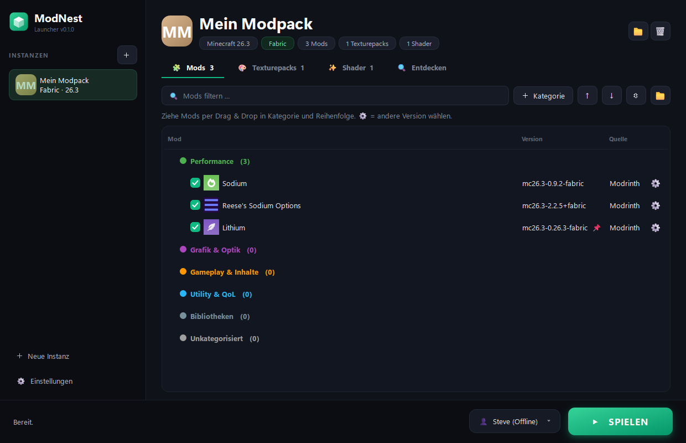
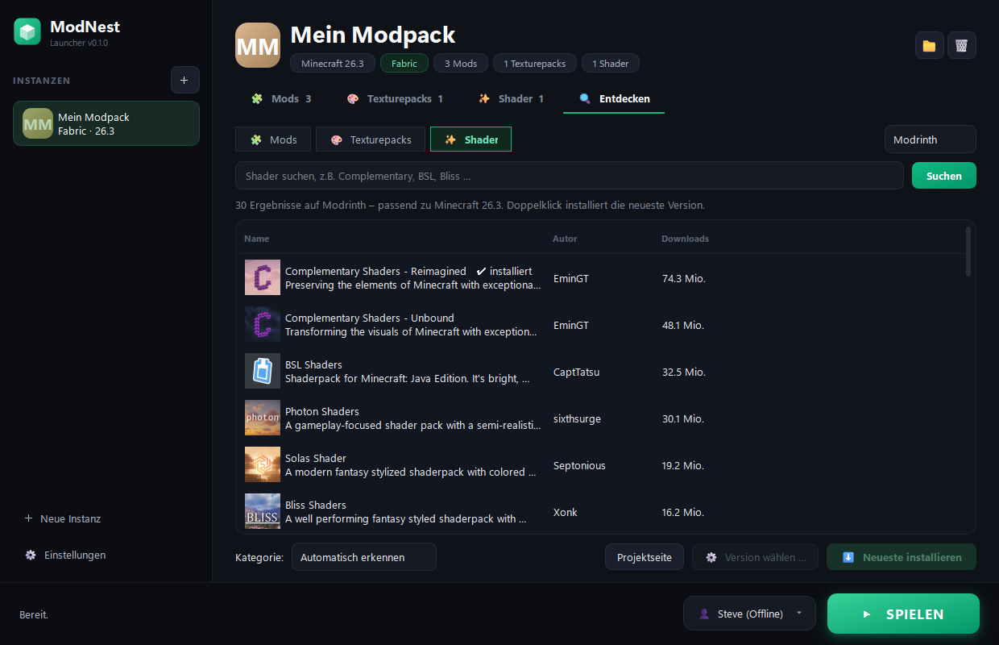
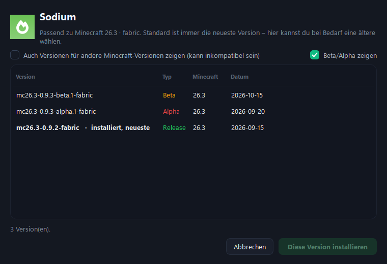

# ⛏ ModNest Launcher

Ein Minecraft-Launcher für Windows, mit dem du **Mods, Texturepacks und Shader** direkt von **Modrinth** und **CurseForge** installierst und so ordnest, wie du willst: per **Drag & Drop** und in **eigenen Kategorien** wie „Performance“, „Grafik & Optik“ oder „PvP“.

  

## Features

**Mods, Texturepacks & Shader verwalten**
- Je ein eigener Tab für Mods, Texturepacks und Shader, alle mit denselben Funktionen
- **Drag & Drop**: Einträge in jede Reihenfolge und jede Kategorie ziehen, auch ganze Kategorien verschieben
- **Eigene Kategorien** anlegen, umbenennen, einfärben und löschen
- Neue Inhalte werden anhand der Modrinth-/CurseForge-Kategorien **automatisch einsortiert**
- Per Checkbox aktivieren oder deaktivieren, ohne etwas zu löschen
- **⚙ Versionswahl**: per Klick auf das Zahnrad auf eine ältere oder neuere Version wechseln (optional, Standard ist immer die neueste)
- **Texturepack-Reihenfolge** wird beim Start automatisch ins Spiel übernommen
- Ein Klick installiert **Iris**, wenn Shader genutzt werden sollen

**Entdecken & Installieren**
- Suche auf **Modrinth** und **CurseForge** (für CurseForge wird ein eigener, kostenloser API-Key benötigt)
- Ergebnisse werden automatisch nach Minecraft-Version und Mod-Loader der Instanz gefiltert
- **Pflicht-Abhängigkeiten** wie die Fabric API werden mitinstalliert

**Spielen**
- Beliebig viele **Instanzen** mit eigener Minecraft-Version und eigenem Loader: Vanilla, Fabric, Quilt, Forge oder NeoForge
- Minecraft, Mod-Loader und die passende **Java-Version** werden automatisch heruntergeladen
- **Offline-Konten** und **Microsoft-Login** (Device-Code-Flow, Tokens mit Windows-DPAPI verschlüsselt)
- Modernes dunkles Design und Startbildschirm mit Ladebalken, kein Konsolenfenster

  
  

## Installation

Voraussetzung: **Windows** und **[Python 3.10+](https://www.python.org/downloads/)**

1. Repository herunterladen (grüner Button **Code → Download ZIP**) und entpacken.
2. **`start.bat`** doppelklicken. Beim ersten Start wird die Python-Umgebung eingerichtet, was etwa eine Minute dauert. Außerdem wird die Verknüpfung **ModNest** auf dem Desktop angelegt.
3. Danach startest du den Launcher einfach über die Verknüpfung **ModNest**.

Alle Daten (Instanzen, Einstellungen, Konten) liegen unter `%APPDATA%\ModNest`.

## CurseForge-API-Key

CurseForge verlangt für Drittanbieter-Launcher einen eigenen API-Key. Den bekommst du kostenlos auf [console.curseforge.com](https://console.curseforge.com) und trägst ihn im Launcher unter **⚙ Einstellungen** ein. Modrinth funktioniert ohne Key.

## Microsoft-Login

Microsoft verlangt, dass jeder Launcher eine eigene, für Minecraft freigeschaltete Azure-App verwendet:

1. Auf [portal.azure.com](https://portal.azure.com) unter **App-Registrierungen** eine neue App anlegen (Kontotyp: persönliche Microsoft-Konten).
2. Unter **Authentifizierung → Erweiterte Einstellungen** die Option **„Öffentliche Clientflows zulassen“** auf **Ja** stellen.
3. Die **Anwendungs-ID (Client-ID)** im Launcher unter **⚙ Einstellungen** eintragen.
4. Die Freischaltung für die Minecraft-API beantragen: [aka.ms/mce-reviewappid](https://aka.ms/mce-reviewappid)

Ohne Microsoft-Login kannst du mit einem **Offline-Konto** im Einzelspieler und im LAN spielen.

## Technik

- Python mit [PySide6](https://doc.qt.io/qtforpython-6/) (Qt) für die Oberfläche
- [minecraft-launcher-lib](https://codeberg.org/JakobDev/minecraft-launcher-lib) für Installation und Start
- [Modrinth API](https://docs.modrinth.com/api/) und [CurseForge API](https://docs.curseforge.com/rest-api/)

---

*Nicht offiziell mit Mojang Studios oder Microsoft verbunden. Minecraft ist eine Marke von Mojang Studios.*
